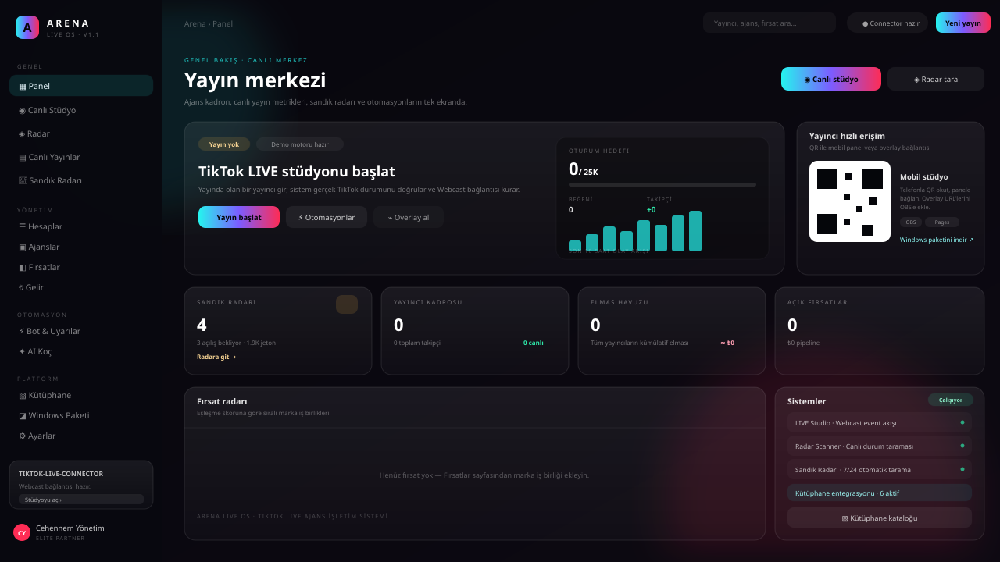
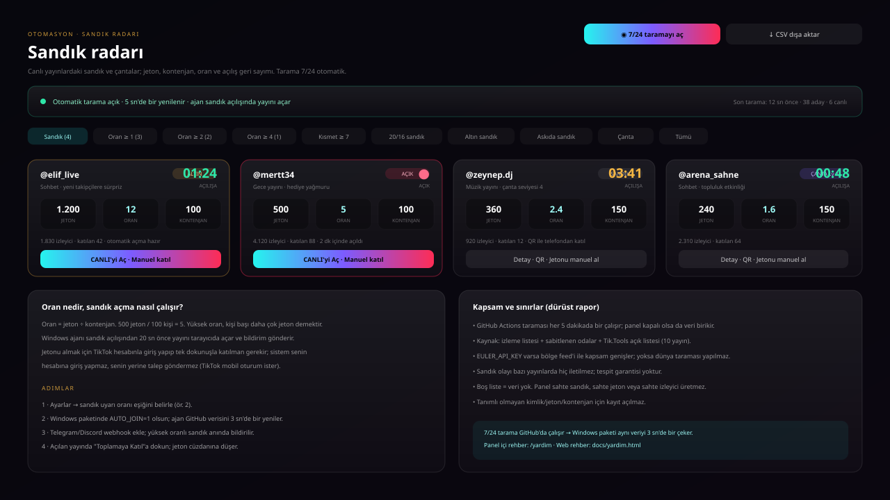
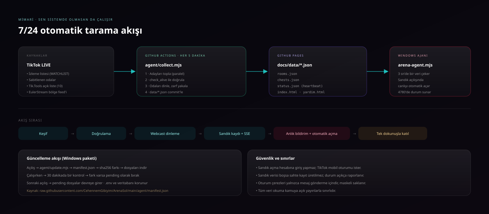
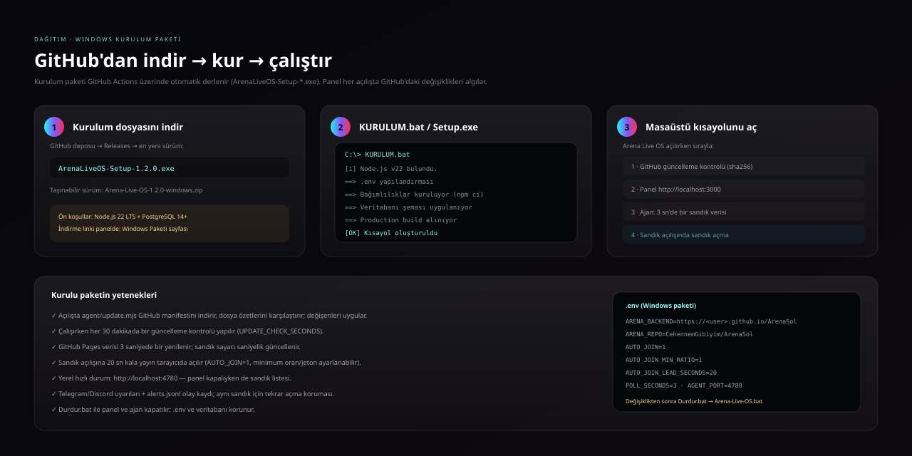

# Arena Live OS

TikTok LIVE ajansları için uçtan uca işletim paneli: canlı stüdyo, sandık radarı, otomatik keşif, overlay kütüphanesi ve Windows kurulum paketi.

**Web (GitHub Pages):** https://cehennemgibiyim.github.io/ArenaSol/ · **Yardım:** [`docs/yardim.html`](docs/yardim.html) · **Windows:** [Releases](https://github.com/CehennemGibiyim/ArenaSol/releases)



> **GERÇEK VERİ KURALI:** Panelde demo/simülasyon sandığı yoktur. Canlı durum, izleyici, hediye elması ve sandık zarfı yalnızca gerçek TikTok uçlarından veya GitHub tarama verisinden gelir. Yayında olmayan hesap için oturum açılmaz; veri yoksa liste boş kalır ve nedeni yazılır.

## İçindekiler

- [Öne çıkan sistemler](#öne-çıkan-sistemler)
- [7/24 otomatik tarama (sen sistemde olmasan da)](#7/24-otomatik-tarama-sen-sistemde-olmasan-da)
- [Windows kurulum paketi](#windows-kurulum-paketi)
- [Açılışta otomatik güncelleme](#açılışta-otomatik-güncelleme)
- [Sandık açma asistanı](#sandık-açma-asistanı)
- [Hızlı başlangıç (web + yerel panel)](#hızlı-başlangıç-web--yerel-panel)
- [Dosya haritası](#dosya-haritası)
- [API](#api)
- [Kapsam ve dürüst sınırlar](#kapsam-ve-dürüst-sınırlar)

## Öne çıkan sistemler

| Sistem | Açıklama | Uç |
| --- | --- | --- |
| **Canlı Stüdyo** | Chat, hediye, beğeni, takip, paylaşım; top gifter, hedef barı, oturum geçmişi | `/canli`, `POST /api/live/sessions` |
| **Radar** | Toplu canlı durum kontrolü (`fetchIsLive`), aday skorlama, pipeline | `/radar`, `POST /api/live/check` |
| **Sandık Radarı** | Sandık/çanta, jeton, kontenjan, oran, açılış geri sayımı, QR ile katılma, 16 sekme, 9 sıralama | `/sandik`, `GET /api/chests`, `GET /api/chests/stream` (SSE) |
| **Canlı Yayınlar** | Keşfedilen yayıncılar kalıcı, sabitleme, izleyici/sandık takibi | `/yayinlar`, `GET /api/rooms` |
| **Eşzamanlı tarayıcı** | Worker pool ile N oda paralel dinleme; doğrulanan oda `listener_jobs` sırasına girer | `POST /api/radar/scan` |
| **Küresel kapsam** | 123 bölge paralel tarama (EULER_API_KEY ile bölge feed'i) | `POST /api/radar/scan` |
| **Local Agent** | Kendi bilgisayarında çalışan paralel dinleyici + sandık açma asistanı | `agent/arena-agent.mjs`, `POST /api/ingest` |
| **GitHub Web Kütüphanesi** | Zero-dependency `arena-widget.js`, GitHub Pages, OBS overlay | `GET /api/packages/library` |
| **Windows Paketi** | `KURULUM.bat`, PowerShell sihirbazı, NSIS setup, portable zip, otomatik güncelleme | `GET /api/packages/windows`, Releases |
| **Panel İçi Yardım** | Resimli kurulum/kullanım rehberi, ortam değişkenleri, sorun giderme | `/yardim` |
| **Gelir / Fırsatlar / Hesaplar** | Elmas→TL, komisyon, tahsilat; tam CRUD, CSV | `/gelir`, `/firsatlar`, `/hesaplar` |
| **AI Koç** | Yayın senaryosu, hediye stratejisi, marka teklifi (OpenAI opsiyonel) | `/ai`, `POST /api/ai/chat` |



## 7/24 otomatik tarama (sen sistemde olmasan da)

Tarama **GitHub Actions** üzerinde çalışır; panel veya bilgisayarın kapalı olsa da veri birikir.



| Bileşen | Görev |
| --- | --- |
| `.github/workflows/collect.yml` | Her **5 dakikada** `agent/collect.mjs` çalışır: keşif → `check_alive` doğrulama → kısa WebSocket dinleme → zarf yakalama |
| `docs/data/rooms.json` | Doğrulanmış canlı odalar (izleyici, kaynak, bölge) |
| `docs/data/chests.json` | Aktif sandıklar (jeton, kontenjan, oran, açılış); önceki turun süresi geçmemiş sandıkları korunur |
| `docs/data/status.json` | Heartbeat: son tur, süre, aday/canlı/sandık sayısı |
| `.github/workflows/deploy.yml` | `docs/` klasörünü GitHub Pages'e yayınlar |

**Kapsam:** izleme listesi (`WATCHLIST`) + sabitlenen odalar + [Tik.Tools açık listesi](https://tik.tools/docs) (en fazla 10 yayın) + `EULER_API_KEY` varsa bölge feed'i. Liste boşsa boş olarak raporlanır; sahte kayıt üretilmez. Detay: [docs/RADAR-DINLEME.md](docs/RADAR-DINLEME.md)

## Windows kurulum paketi



Kurulum paketi GitHub Actions içinde **otomatik derlenir** ([`.github/workflows/windows-release.yml`](.github/workflows/windows-release.yml)):

1. `npm ci` → `npm run typecheck` → `npm run build`
2. `node scripts/build-exe.mjs` → `release/Arena-Live-OS/` + portable zip
3. `makensis scripts/installer.nsi` → `release/ArenaLiveOS-Setup-<sürüm>.exe`
4. GitHub Release'e yüklenir (`.exe` + `.zip` artifact)

Kullanıcı tarafı:

```text
ArenaLiveOS-Setup-1.2.0.exe   → çift tıkla, kur, masaüstü kısayolunu aç
Arena-Live-OS-1.2.0-windows.zip → aç → KURULUM.bat
```

```bat
KURULUM.bat        :: Node kontrolü, .env, npm ci, drizzle push, build, masaüstü kısayolu
Arena-Live-OS.bat  :: güncelleme kontrolü → panel (localhost:3000) + ajan
Durdur.bat         :: panel ve ajanı kapatır
```

Gereksinim: **Windows 10/11 64-bit · Node.js 22 LTS · PostgreSQL 14+**. Ayrıntı: [docs/WINDOWS-KURULUM.md](docs/WINDOWS-KURULUM.md)

## Açılışta otomatik güncelleme

`agent/update.mjs` her açılışta `raw.githubusercontent.com/<repo>/main/agent/manifest.json` dosyasını indirir ve dosya bazında **sha256** karşılaştırır:

- Farklı dosyalar indirilir, `.mjs` betikleri Windows'ta kilitli olduğu için `.pending` bırakılır; sonraki açılışta devreye girer.
- `.env`, veritabanı ve kullanıcı verisi korunur.
- Ajan çalışırken **30 dakikada bir** yeniden kontrol eder (`UPDATE_CHECK_SECONDS`).
- Sonuç `agent/data/update.json` dosyasına yazılır.

Manifest'i güncellemek için:

```bash
npm run manifest   # = node scripts/build-agent-manifest.mjs
```

## Sandık açma asistanı

Windows ajanı sandık açılışına yaklaşınca yayını otomatik açar ve bildirim gönderir:

```env
AUTO_JOIN=1
AUTO_JOIN_MIN_RATIO=1        # oran = jeton ÷ kontenjan
AUTO_JOIN_MIN_COINS=100
AUTO_JOIN_LEAD_SECONDS=20    # açılıştan kaç saniye önce
AUTO_JOIN_COOLDOWN_SECONDS=1800
POLL_SECONDS=3               # GitHub verisi yenileme
```

- Veri GitHub Pages'ten **3 saniyede** bir yenilenir, yoksa panel SSE (`/api/chests/stream`) ile anında itilir.
- Aynı sandık için tekrar açma koruması vardır; tüm açmalar `agent/data/alerts.jsonl` dosyasına yazılır.
- Yerel hızlı durum sayfası: `http://localhost:4780` (panel kapalıyken de sandık listesi).

> **Dürüst sınır:** Sandık açma asistanı yalnızca yayını açar ve bildirir; **jeton toplamaz**. TikTok zarf/jeton toplama mobil oturum ister; sistem hesabına giriş yapmaz ve senin adına talep göndermez.

## Hızlı başlangıç (web + yerel panel)

### Web paneli (GitHub Pages)

1. Depo → **Settings → Pages** → Source: **GitHub Actions**
2. **Actions → Deploy web panel to GitHub Pages** çalıştır
3. `https://<kullanıcı>.github.io/ArenaSol/` adresini aç · Yardım: `/yardim.html`

### Yerel panel

```bash
npm ci
cp .env.example .env          # DATABASE_URL düzenle
npx drizzle-kit push
npm run build && npm run start
# İlk veri (sahte sandık üretmez):
curl -X POST http://localhost:3000/api/demo/seed
```

Panel: `http://localhost:3000` · Yardım: `http://localhost:3000/yardim` · Ajan: `agent/baslat.bat` veya `Arena-Agent.bat`

## Dosya haritası

```text
.github/workflows/
  collect.yml          7/24 tarama (5 dk) → docs/data/*.json commit
  deploy.yml           GitHub Pages yayını
  windows-release.yml  Windows setup.exe + zip → GitHub Release
agent/
  collect.mjs          Actions tarayıcısı (keşif + doğrulama + dinleme)
  arena-agent.mjs      Windows ajanı: GitHub verisi, SSE, sandık açma, 4780 durum
  update.mjs           Açılışta/çalışırken GitHub güncelleme kontrolü
  manifest.json        Dosya özetleri (npm run manifest)
scripts/
  install-windows.ps1  Kurulum sihirbazı
  build-exe.mjs        Portable paket + zip
  installer.nsi        NSIS kurulum betiği
  build-agent-manifest.mjs
docs/                  GitHub Pages paneli + yardım + veri
public/help/*.svg      README ve panel içi yardım görselleri
src/app/yardim/        Panel içi resimli rehber
```

## API

`GET /api/rooms` · `POST /api/rooms` · `PATCH/DELETE /api/rooms/[id]` · `POST /api/ingest` · `GET /api/chests` · `GET /api/chests/stream` (SSE) · `GET/PATCH/DELETE /api/chests/[id]` · `GET /api/chests/export` · `GET/POST /api/live/sessions` · `GET /api/live/feed` · `GET/POST /api/live/check` · `GET/POST /api/radar/scan` · `GET/PUT /api/settings` · `GET/POST /api/resources/[resource]` · `PATCH/DELETE /api/resources/[resource]/[id]` · `GET /api/qr?text=` · `POST /api/ai/chat` · `POST /api/demo/seed?force=1` · `GET /api/packages/windows` · `GET /api/packages/library` · `GET /api/health`

## Kapsam ve dürüst sınırlar

- Anahtarsız "bütün ülkeler" feed'i yoktur; anahtarsız kapsam kayıtlı hesaplar + sabitlenenler + bulunan odalar + 10 yayınlık açık listedir. Ölçümler: [docs/RADAR-DINLEME.md](docs/RADAR-DINLEME.md)
- Sandık olayı bazı yayınlarda hiç iletilmeyebilir; tespit garantisi yoktur. Eksik kimlik/jeton/kontenjan için kayıt açılmaz.
- Sandık açma hesabınıza giriş yapmaz; TikTok mobil oturumu gerektirir.
- TikTok LIVE verisi resmi olmayan Webcast protokolünden okunur. `tiktok-live-connector` MIT lisanslıdır ve TikTok ile bağlantılı değildir. Yalnızca kamuya açık yayınları okumak için kullanın.

MIT · Arena Live OS
